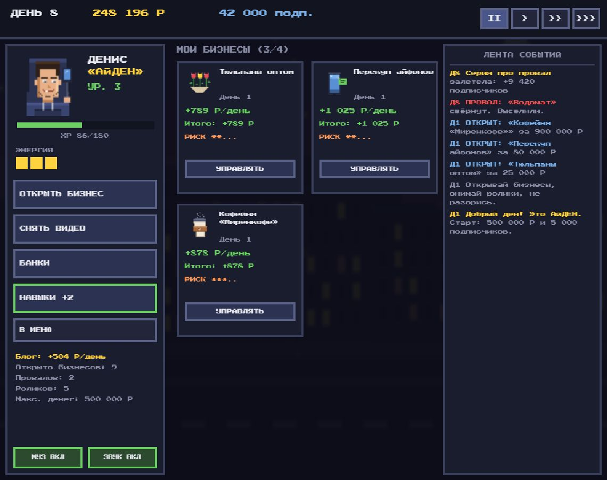

# АЙДЕН: Бизнес-Империя

Пиксель-арт **бизнес-симулятор + RPG** про блогера АЙДЕНа (Дениса Меренкова) —
серийного предпринимателя, у которого каждый бизнес рано или поздно проваливается.
Но каждый провал — это контент, а контент — это подписчики и реклама.

Игра сделана на движке **PointJS** и работает в браузере (в первую очередь Google Chrome).



**Играть онлайн:** https://kennygomel.github.io/iden-game/

## Как запустить

**Вариант 1 (рекомендуется)** — локальный сервер:

```bash
node tools/serve.js
```

Открой в Chrome: **http://localhost:8080**

**Вариант 2** — просто открой `index.html` двойным кликом в Chrome.
(Шрифт подтягивается из Google Fonts — нужен интернет; без него будет моноширинный запасной.)

## Управление

- **Мышь** — все клики и кнопки.
- **Пробел** — пауза / продолжить.
- **Esc** — закрыть окно (кроме событий — их надо решить).
- **МУЗЫКА / ЗВУКИ** — отдельные переключатели фоновой музыки и звуковых эффектов
  (в меню под кнопками и в левой панели игры). Состояние запоминается.

Фон играет 8-битный lo-fi луп (сгенерирован кодом, как и все ассеты).

## Как играть

Ты — Денис «АЙДЕН». На старте: **500 000 ₽**, **5 000 подписчиков** и 3 единицы энергии.

- **Открывай бизнесы** (кнопка «ОТКРЫТЬ БИЗНЕС») — от тюльпанов и перекупа айфонов
  до кофейни «Миренкофе», ПВЗ Ozon/Wildberries, биотуалетов и франшизы пиццерии.
  Одновременно можно вести несколько бизнесов — сколько влезет на экран и по деньгам,
  но **каждый вид — только в одном экземпляре**: вторая кофейня при живом флагмане
  не откроется. Закрыл точку — вид снова доступен.
- **Каждый день** бизнесы приносят выручку и жрут расходы, блог капает рекламой,
  по кредитам набегают проценты, а на бизнесы сыплются события.
- **События** — сердце игры: арендодатель поднял аренду, инвестор ушёл,
  партнёр слил кассу, франшизодатель поднял роялти, санэпид оштрафовал...
  Часть событий роковая — бизнес придётся свернуть. Так и задумано.
- **Провал = контент.** Когда бизнес схлопывается, выходит огненная серия —
  подписчики прут, а следующие ролики дают **x2.5** прирост.
- **Снимай видео** — производство стоит **100 000–500 000 ₽** (шагами по 50 000).
  Каждый шаг приносит 25 000–100 000 подписчиков, итого за ролик — от 50 000 до 1 000 000.
  Лимит — **4 видео в месяц**. Подписчики увеличивают рекламный доход блога.
  Но помни: бизнесы в среднем убыточны — навыки лишь сокращают минус,
  а проценты по кредитам списываются каждый день.
- **Кредиты**: Т-Банк (дорого, но одобряют всем) и Альфа-Банк (дешевле, нужен 3 уровень).
  Проценты капают на долг каждый день.
- **Прокачивайся**: XP за дни и действия, очки навыков за уровни —
  переговоры, маркетинг, экономия, харизма.

**Проигрыш:** долговая яма глубже **−150 000 ₽** → банкротство и экран статистики.
**Цель:** сколько продержишься и сколько подписчиков соберёшь.

## Структура проекта

```
├── index.html              — страница игры (шрифт, подключение скриптов)
├── pointjs.js              — движок PointJS
├── pointjs_ai.js           — документация движка для ИИ
├── js/
│   ├── data.js             — бизнесы, события, банки, навыки, достижения
│   └── game.js             — состояние, экономика, UI, игровые циклы
├── resources/              — пиксель-арт (PNG) и звуки (WAV)
└── tools/
    ├── gen_assets.js       — генератор всех PNG-спрайтов и WAV-звуков
    └── serve.js            — простой локальный сервер
```

## Деплой

Сайт публикуется на **GitHub Pages** из ветки `main`:
**https://kennygomel.github.io/iden-game/**

Обновление игры: закоммить изменения и запушь в `main` — Pages пересоберётся автоматически.

## Ассеты

Все спрайты и звуки нарисованы/сгенерированы кодом — без внешних ассетов.
Перегенерировать:

```bash
node tools/gen_assets.js
```

Прогресс сохраняется в `localStorage` автоматически каждый игровой день.

---

*Фанатская игра, сделана по мотивам публичных видео блогера АЙДЕНа.
Все совпадения случайны, экономика вымышленная.*
